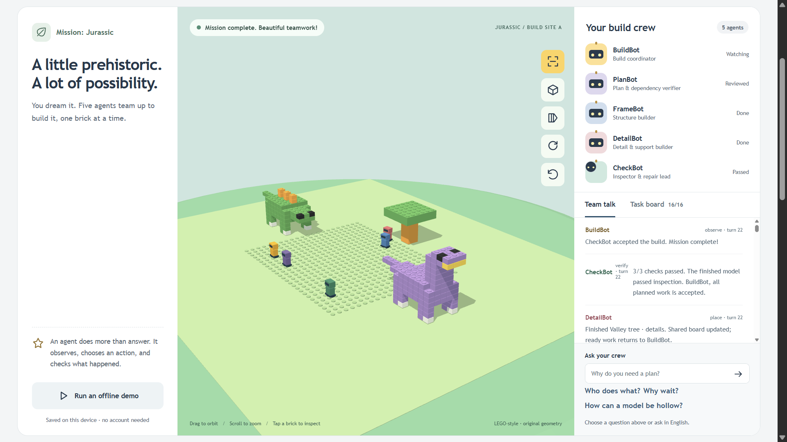

# BrickLab

**Build something. Watch a team coordinate. Find out why it works.**

BrickLab is a hands-on lab for exploring agent teamwork, designed for ages
11-15 and curious adults. Describe a dinosaur or spacecraft, follow the task
handoffs, then hide bricks and ask the team to repair the build.

Offline templates need no model account. Optional AI planning proposes original
brick geometry; the five visible agents execute and inspect it deterministically.
They are not five language-model calls.



*A completed offline example, not model-generated output.*

See the [screenshot gallery](docs/screenshots.md) for offline builds, a hosted
Azure image-inspired station, the task board and a playground repair.

## Try it

**Local computer:** with Node.js 22.12+ and npm, run from the repository root:

```sh
npm ci
npm run dev
```

Open **http://127.0.0.1:4173**, choose **Change mode -> Use offline templates**,
then **Run an offline demo**. No API key, Azure subscription or model download
is needed for this path.

Prefer a browser workspace? [Create a private Codespace](https://codespaces.new/ribumann/lego-builder-agents),
then follow the [Codespaces connection steps](docs/lab-organizer.md#private-codespaces).
Its server starts automatically: do not run the local commands beside it.
Codespaces usage limits and charges may apply.

## Choose your path

| I want to... | Start here |
| --- | --- |
| **Organize a lab** | [Organizer guide](docs/lab-organizer.md): choose a setup, rehearse, facilitate and unblock a group |
| **Take the lab** | [Student guide](docs/student-guide.md): connect, build, investigate and reflect |
| **Understand the architecture** | [Architect guide](docs/architecture.md): L0-L2 views, trust boundaries and deployment choices |
| **Develop or experiment** | [Developer guide](docs/software-design.md): L1-L4 views, code, decisions, history and checks |

Before a workshop or release, follow the [step-by-step UAT guide](docs/uat-guide.md)
and record acceptance separately for local, Codespaces, provider and Azure paths.

Use the lab, adapt the exercises, and collaborate through
[issues](https://github.com/ribumann/lego-builder-agents/issues) and pull requests.
Describe your setup and expected behavior; leave out private briefs, credentials
and raw diagnostic logs.

**Before using AI:** only an explicit submission sends your brief to the selected
provider and may consume quota or incur charges. Start offline; use synthetic
ideas, not personal information. Saves stay in this browser; exported files
include the brief. Source capabilities are not proof that a particular deployment
works: see [release evidence](docs/architecture.md#deployment-and-release-evidence).

Independent educational demo, not affiliated with or endorsed by the LEGO Group
or Microsoft. Stylized bricks are not physical construction instructions.
