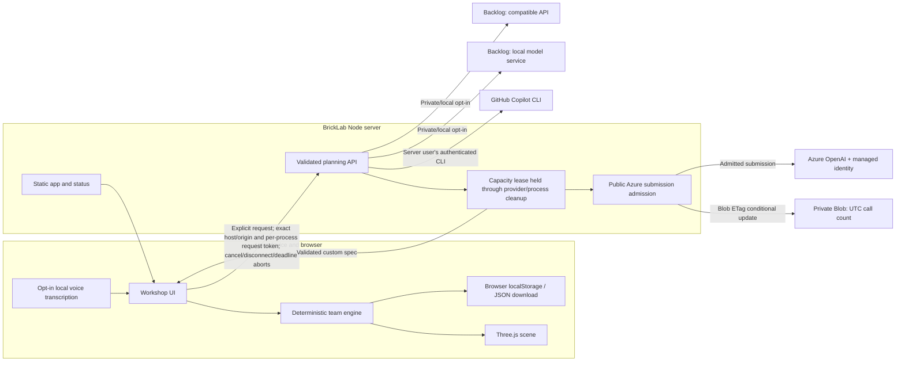

# BrickLab architecture and MVP boundaries

This describes merged release `c0060c7af8bd5a1c748a76b10e7710e35cf051e6`
and the available deployment evidence. It is not a claim that every deployment
path or user journey has passed end-to-end acceptance.
The [README](../README.md) is the practical setup and capability guide;
[software design](software-design.md) describes the core behavior.

## System shape

The browser owns the interactive simulation, rendering, replay, and local saves.
The Node server serves the application and, only when configured, brokers an
explicit planning request to a provider. The provider proposes a custom geometry
specification; BrickLab validates it before constructing a deterministic local
plan. The five visible roles are application logic, not five model calls.

## Deployment and release evidence

| Target | MVP boundary | Current evidence and limitation |
| --- | --- | --- |
| Local server | Run the application on loopback; offline templates work without a provider. Copilot planning is an explicit, separately configured action. | Earlier Windows ARM64 candidates completed bounded text and consented synthetic-image requests. Copilot authentication, inference and manual acceptance on merged revision `c0060c7af8bd5a1c748a76b10e7710e35cf051e6` remain unverified. |
| Private Codespaces | Keep the forwarded port private; configure the production server, Copilot CLI login, and BrickLab's separate temporary app password as described in the README. | Setup guidance and automated fixtures exist, but real Codespaces setup and manual UAT have not been reported. Do not make the port public to troubleshoot. |
| Azure-hosted app | Anonymous hosted planning uses backend managed identity and the shared submission limit. | Azure owner confirms merged revision `c0060c7af8bd5a1c748a76b10e7710e35cf051e6` live with GPT-6.1 Terra selected, exact package/settings verified, and public HTTPS 200 with the expected asset on 2026-11-16. One earlier synthetic 100-brick airplane completed planning and local build; this is not broad reliability, current live inference/correction-path validation or user acceptance. |

Earlier read-only Azure inventory recorded Front Door Standard
with WAF Prevention and a 240-second profile origin-response timeout; Linux
App Service B1 in Italy North; private Blob storage and an approved private
endpoint in Sweden Central; and Azure OpenAI deployments for `gpt-4.1-mini`
and GPT-5.4 in Sweden Central, both attached to `Microsoft.DefaultV2`. Azure
owner then reported app settings `BRICKLAB_HOSTED=1` and
`BRICKLAB_AZURE_AI=0`; its package uses the system-assigned identity. A private
VM runner was deallocated. These observations describe earlier infrastructure
inventory, not the current planner setting. The owner confirms the live
application runs merged revision
`c0060c7af8bd5a1c748a76b10e7710e35cf051e6` with
`BRICKLAB_HOSTED=1`, `BRICKLAB_AZURE_AI=1`, and the system-assigned identity.
Its configured planner is
`AZURE_OPENAI_DEPLOYMENT=bricklab-planner-terra`,
gpt-6.1-terra version 2026-10-26, GlobalStandard capacity 40, the
`bricklab-public-safe` policy and automatic upgrades disabled. GPT-5.4 capacity
200 is retained without automatic fallback; all existing guards and the
call-count ledger remain preserved. GlobalStandard is not EU-processing
restricted. The deployment owner verified the exact package/settings, and
public HTTPS returned 200 with asset `index-B5T0Pdlt.js` on 2026-11-16. These
checks confirm package/endpoint availability, not a fresh paid inference or
user acceptance.

The owner also verified HTTPS-only/TLS 1.2, HTTP-to-HTTPS redirect, Front Door
routing with WAF Prevention and its approximate 10-per-minute planner rule,
exact Front Door-ID-bound origin allow plus default deny, and independent SCM
deny-all; direct App Service origin returned 403. The managed identity has
`Cognitive Services OpenAI User` on the dedicated account,
`Storage Blob Data Reader` on the package container, and
`Storage Blob Data Contributor` on the usage container; storage is private.
A same-origin invalid-world request returned 400 without changing quota status
or calling the provider. These are bounded configuration/path checks, not a
full security assessment. No live quota/capacity-denial,
cancellation/disconnect, or 300-second timeout/cleanup test has been reported;
Front Door's configured 240-second origin timeout does not verify delivery of
a 300-second request.

### Simplified hosted-planning contract and evidence boundary

The source implements the following user-approved simplification, covered by
mock/unit and browser checks. The owner confirms the merged release package and
settings are live. The single earlier Terra result above verifies one
representative planning/build path, not broad reliability, every cleanup edge
case or current live inference.

- Hosted visitors are anonymous; the backend uses managed identity for Azure
  services. Visitor Entra sign-in and visitor client-hash keys are not used.
- Hosted planning targets 20 total slots and 20 per provider.
  A 20-slot deployment requires one worker and one Node process; it is not an
  upstream capacity guarantee. Private mode defaults to 8 total
  and 2 per provider. Local and Codespaces have no application daily-call
  quota.
- Public Azure planning counts valid admitted submissions against a shared
  limit of 50 per UTC day by default (`BRICKLAB_AZURE_DAILY_CALLS`, integer
  1-100). The private Blob counter uses ETag conditional writes. It is an
  application call-count admission record, not a monetary reservation or
  billing cap. Each submission allows at most two same-provider requests, with
  one correction only for a completed invalid design. Up to 100 Azure model
  requests can therefore follow 50 submissions, with no second count,
  correction-specific refund or reset. Both attempts share one slot and deadline;
  transport/auth/429/timeout failures are not replayed. The revised design
  removes the estimated-dollar ledger, price
  verification, pinned model/version/region/price constraints, and six-minute
  day-boundary blackout. A submission limit is not a billing cap.
- Hosted configuration uses `BRICKLAB_HOSTED=1`, explicit
  `BRICKLAB_AZURE_AI=1`,
  `BRICKLAB_HOSTED_ORIGIN`, `AZURE_OPENAI_ENDPOINT` and
  `AZURE_OPENAI_DEPLOYMENT`; public Azure accounting uses
  `AZURE_STORAGE_ACCOUNT` and either `BRICKLAB_AZURE_USAGE_CONTAINER` or the
  legacy `BRICKLAB_AZURE_BUDGET_CONTAINER`. Source defaults keep hosted paid
  planning off unless explicitly enabled; the checked-in Bicep also defaults
  `BRICKLAB_AZURE_AI=0`. The live preview's selected Terra deployment and
  package/settings are owner-confirmed, but the Bicep default does not establish
  a live app setting. Secrets and resource identifiers are not published here.
- The app checks exact Host/Origin values and bounds request/response sizes.
  The Bicep template defaults App Service and SCM ingress to deny, allowing
  Front Door backend traffic only with the configured `x-azure-fdid`; source
  configuration uses managed identity and the approved native Azure content
  policy. Public visitors remain anonymous; Codespaces additionally requires
  the private forwarded port and its separate temporary Basic-auth credential.
  The owner confirmed live origin/SCM restrictions and direct-origin denial
  above; this is not an independent end-to-end security assessment. Consented
  and validated Azure image requests are implemented in source. Live vision
  behavior has not been verified.
- The backend applies a 300-second HTTP deadline to Copilot, Azure, and
  compatible-provider planning; Local AI has a separate 90-second limit. On
  timeout it aborts the provider request; capacity remains held until cleanup
  settles. Its tests cover the HTTP-to-Windows text-job timeout path, slot
  retention through confirmed cleanup, and quarantine when cleanup cannot be
  confirmed. An HTTP abort cannot prove remote model computation or billing
  stopped. CI covers the implemented abort, cleanup-wait and quarantine paths.

The merged PR #21 tree-equivalent test head
`0ad0b55740c99f9e59fff3511390ee0b26daf828` passed check run
`43812538493` (286 passed, 10 skipped). The separate prompt/output latency
experiment is not shipped; paired measurements did not demonstrate an
end-to-end improvement. No 2x speed or throughput increase is measured.

The backend's 300-second deadline is distinct from Azure Front Door's
documented origin response timeout, which is profile-wide and configurable
from 16 to 240 seconds
([Microsoft Learn](https://learn.microsoft.com/en-us/azure/frontdoor/how-to-configure-origin#origin-response-timeout)).
That setting does not establish a hard limit for an already-streaming response.
Live long-stream reliability and real-timeout behavior remain unverified.

## Trust and data boundaries

- On a local run, the server listens on loopback by default. Exact Host/Origin,
  a per-process request token, bounded input, and provider opt-ins protect its
  planning routes; this is not a hardened public multi-user service.
- Codespaces adds exact forwarded-host/origin checks, a separate app login, and
  a fresh GitHub CLI check that the port is private. GitHub/Copilot sign-in and
  BrickLab's app password are distinct credentials. Never publish the port or
  paste GitHub credentials or tokens into BrickLab or chat. For the private
  app's HTTPS Basic Authentication prompt only, enter username `bricklab` and
  the temporary app password printed in the Codespace terminal; never use a
  GitHub password or token there.
- The owner-confirmed `c0060c7` public hosted app serves the selected Terra
  planner and exact release asset over HTTPS. The earlier representative
  planning/build result is limited to one synthetic case. The design is
  anonymous at the visitor boundary; Azure managed identity is the backend's
  service identity.
  Host and Origin checks alone are not authentication, and forwarded client
  headers do not establish a trusted identity.
- A submitted brief is sent only after the user explicitly starts planning.
  Depending on the selected provider, it goes to GitHub, a configured local or
  compatible service, or Azure. Consented, validated Azure image planning is
  implemented in source. Image planning requires explicit consent; original
  image metadata is not stripped.
- Voice transcription runs in the browser after explicit microphone consent.
  First use downloads the model from its publisher; audio and transcript are
  not sent by the voice module. A later plan submission follows the selected
  planner's separate disclosure.
- Browser saves and playground memory are local to the browser. Downloads are
  files, not a sharing service. A shared application call limit is not an
  invoice cap.

The MVP controls in this repository apply to BrickLab and its dedicated Azure
resources. Subscription-wide governance and cross-solution spend analysis are
operator responsibilities, not product deliverables or release blockers.

## Scope decisions

- **MVP:** offline templates, the deterministic team and inspector, custom
  planning subject to validation, scene append, replay, local persistence, and
  the documented local/Codespaces/Azure deployment boundaries.
- **Stretch:** improve and validate voice input; automatic onset/silence handling
  is not implemented and real-microphone usability is not accepted. Refactor
  existing code only where required to meet MVP behavior and reliability.
- **Backlog:** OpenAI-compatible custom endpoints and Ollama/local-model
  planning. Code and older setup notes may exist, but these paths are not MVP
  support commitments.
- **Not a physical simulator:** face connectivity and occupied-cell checks do
  not prove clutch strength, collision safety, stability, or buildability.

See [Azure planner notes](azure-planner.md) and
[Azure hosting notes](self-hosting-azure.md) for deployment-specific controls
and their verification status.
