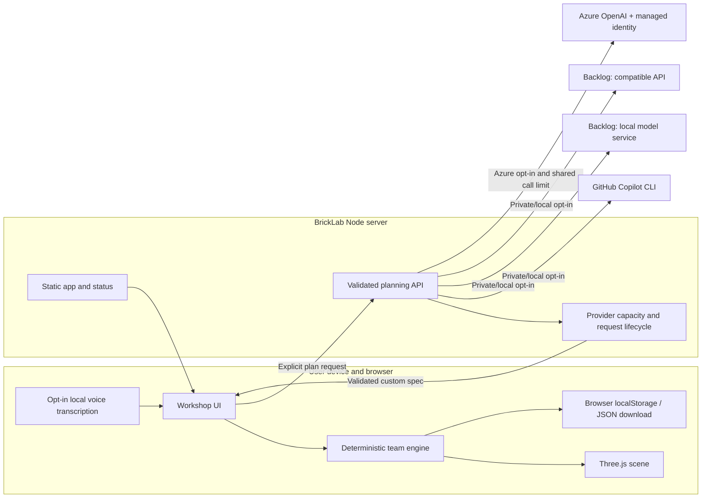

# BrickLab architecture and MVP boundaries

This describes the release target and the evidence available for this candidate.
It is not a claim that every deployment path has passed end-to-end acceptance.
The [README](../README.md) is the practical setup and capability guide;
[software design](software-design.md) describes the core behavior.

## System shape

The browser owns the interactive simulation, rendering, replay, and local saves.
The Node server serves the application and, only when configured, brokers an
explicit planning request to a provider. The provider proposes a custom geometry
specification; BrickLab validates it before constructing a deterministic local
plan. The five visible roles are application logic, not five model calls.

## Deployment and release evidence

| Target | MVP boundary | Current evidence and limitation |
| --- | --- | --- |
| Local server | Run the application on loopback; offline templates work without a provider. Copilot planning is an explicit, separately configured action. | One earlier Windows ARM64 candidate completed a real text request and a consented synthetic-image request. An earlier backend candidate has automated coverage for HTTP timeout, Windows text-job cleanup, and capacity retention; the revised candidate and manual UAT remain unverified. |
| Private Codespaces | Keep the forwarded port private; configure the production server, Copilot CLI login, and BrickLab's separate temporary app password as described in the README. | Setup guidance and automated fixtures exist, but real Codespaces setup and manual UAT have not been reported. Do not make the port public to troubleshoot. |
| Azure-hosted app | The last verified live app is anonymous and serves static/offline use; its public Azure planner was off. The simplified planner is implemented in source, not verified as deployed. | Azure owner confirmed source/package revision `084cfb4b5ec7bed93c362ce8a50f29ae2ab76142`; the custom-domain/Front Door endpoint returned HTTPS 200, `/api/status` reported hosted offline-only, and a direct App Service request returned 403 under the existing Front Door-only origin rules. These observations do not verify a newer release. |

Read-only Azure inventory for the existing deployment: Front Door Standard
with WAF Prevention and a 240-second profile origin-response timeout; Linux
App Service B1 in Italy North; private Blob storage and an approved private
endpoint in Sweden Central; and Azure OpenAI deployments for `gpt-4.1-mini`
and GPT-5.4 in Sweden Central, both attached to `Microsoft.DefaultV2`. Azure
owner reported app settings `BRICKLAB_HOSTED=1` and
`BRICKLAB_AZURE_AI=0`; its package uses the system-assigned identity. A private
VM runner was deallocated. These observations describe the previously
verified site, not a new MVP candidate.

### Simplified hosted-planning source contract (not deployment verification)

The source implements the following user-approved simplification, covered by
mock/unit and browser checks. These are not a claim that the simplified
planner is deployed or that real Azure inference has been verified.

- Hosted visitors are anonymous; the backend uses managed identity for Azure
  services. Visitor Entra sign-in and visitor client-hash keys are not used.
- Hosted planning targets 20 total slots and 20 per provider.
  A 20-slot deployment requires one worker and one Node process; it is not an
  upstream capacity guarantee. Private mode defaults to 8 total
  and 2 per provider. Local and Codespaces have no application daily-call
  quota.
- Public Azure planning targets an atomic shared limit of 50 user submissions per UTC
  day; each allows at most two same-provider requests, with one correction only
  for a completed invalid design. Up to 100 Azure model requests can therefore
  follow 50 submissions, without a second reservation or reset. Both attempts
  share one slot and deadline; transport/auth/429/timeout failures are not
  replayed. The revised design removes the estimated-dollar reservation, price
  verification, pinned model/version/region/price constraints, and six-minute
  day-boundary blackout. A submission limit is not a billing cap.
- The design retains managed identity, network protections, bounded
  request/response sizes, and the approved native Azure content policy.
  Consented and validated Azure image requests are implemented in source. Actual
  attachment, live provider behavior, and final configuration need
  verification.
- The backend applies a 300-second HTTP deadline to Copilot, Azure, and
  compatible-provider planning; Local AI has a separate 90-second limit. On
  timeout it aborts the provider request; capacity remains held until cleanup
  settles. Its tests cover the HTTP-to-Windows text-job timeout path, slot
  retention through confirmed cleanup, and quarantine when cleanup cannot be
  confirmed. An HTTP abort cannot prove remote model computation or billing
  stopped; verify these properties again on the final revision.

The backend's 300-second deadline is distinct from Azure Front Door's
documented origin response timeout, which is profile-wide and configurable
from 16 to 240 seconds
([Microsoft Learn](https://learn.microsoft.com/en-us/azure/frontdoor/how-to-configure-origin#origin-response-timeout)).
That setting does not establish a hard limit for an already-streaming response.
Live long-stream reliability and the real Azure tenant/storage/policy/edge
remain unverified. No 2x speed or throughput increase has been measured.

## Trust and data boundaries

- On a local run, the server listens on loopback by default. Exact Host/Origin,
  a per-process request token, bounded input, and provider opt-ins protect its
  planning routes; this is not a hardened public multi-user service.
- Codespaces adds exact forwarded-host/origin checks, a separate app login, and
  a fresh GitHub CLI check that the port is private. GitHub/Copilot sign-in and
  BrickLab's app password are distinct credentials. Never publish the port or
  paste GitHub credentials or tokens into BrickLab or chat. For the private
  app's HTTPS Basic Authentication prompt only, enter username `bricklab` and
  the temporary app password printed in the Codespace terminal; never use a
  GitHub password or token there.
- The last verified public hosted app served static/offline content only. The
  revised paid route has not been verified live. The design is anonymous at the
  visitor boundary; Azure managed identity is the backend's service identity.
  Host and Origin checks alone are not authentication, and forwarded client
  headers do not establish a trusted identity.
- A submitted brief is sent only after the user explicitly starts planning.
  Depending on the selected provider, it goes to GitHub, a configured local or
  compatible service, or Azure. Consented, validated Azure image planning is
  implemented in source. Image planning requires explicit consent; original
  image metadata is not stripped.
- Voice transcription runs in the browser after explicit microphone consent.
  First use downloads the model from its publisher; audio and transcript are
  not sent by the voice module. A later plan submission follows the selected
  planner's separate disclosure.
- Browser saves and playground memory are local to the browser. Downloads are
  files, not a sharing service. A shared application call limit is not an
  invoice cap.

The MVP controls in this repository apply to BrickLab and its dedicated Azure
resources. Subscription-wide governance and cross-solution spend analysis are
operator responsibilities, not product deliverables or release blockers.

## Scope decisions

- **MVP:** offline templates, the deterministic team and inspector, custom
  planning subject to validation, scene append, replay, local persistence, and
  the documented local/Codespaces/Azure deployment boundaries.
- **Stretch:** improve and validate voice input; automatic onset/silence handling
  is not implemented and real-microphone usability is not accepted. Refactor
  existing code only where required to meet MVP behavior and reliability.
- **Backlog:** OpenAI-compatible custom endpoints and Ollama/local-model
  planning. Code and older setup notes may exist, but these paths are not MVP
  support commitments.
- **Not a physical simulator:** face connectivity and occupied-cell checks do
  not prove clutch strength, collision safety, stability, or buildability.

See [Azure planner notes](azure-planner.md) and
[Azure hosting notes](self-hosting-azure.md) for deployment-specific controls
and their verification status.
