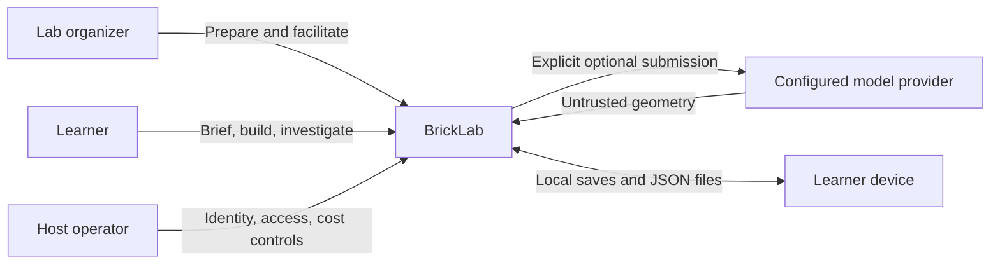
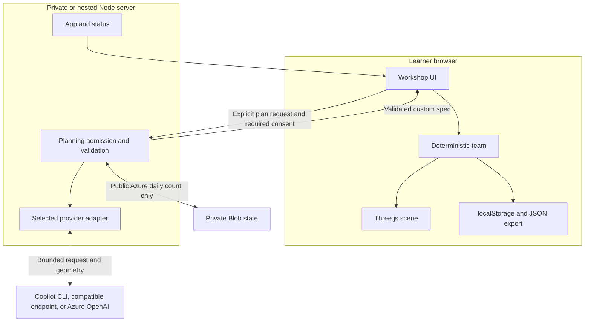

# BrickLab for architects

**One browser workshop, one Node server, optional external planning.**
The model proposes bounded geometry; deterministic application logic schedules,
builds and inspects it. Start with [setup](lab-organizer.md#choose-a-setup) or
continue to [developer-level design](software-design.md).
Use this guide to choose a deployment boundary and explain what the system can
and cannot guarantee.

Here, **L0** means system context, **L1** runtime containers, and **L2**
components. These are navigation levels, not a claim of a separate service per
agent.

## L0: system context

The core lesson works without inference. Copilot, Azure and an operator-configured
OpenAI-compatible service are optional planning paths, not autonomous
multi-model teams. The separate GitHub Models Actions workflow makes three
model decisions and produces an importable artifact; it is not a workshop
runtime provider.

## L1: runtime containers

The browser owns execution, rendering, replay and saves. The server owns provider
configuration, request admission and process/transport cleanup. The browser
validates returned geometry again; external output and imported files are not
trusted. The server is not a shared scene database.

## L2: components and decisions

| Responsibility | Component | Why this boundary |
| --- | --- | --- |
| Explicit workflow and consent | [`src/main.ts`](../src/main.ts) | Choosing a mode is separate from sending a request |
| Shared geometry contract | [`src/custom-design.mjs`](../src/custom-design.mjs) | Server and browser enforce bounds, overlap and expanded counts |
| Tasks, handoffs, inspection, restore | [`src/engine.ts`](../src/engine.ts) | Same deterministic execution for templates and accepted AI plans |
| Scene growth | [`src/scene-append.ts`](../src/scene-append.ts) | Translate only the addition; commit nothing if combined validation fails |
| Rendering | [`src/scene.ts`](../src/scene.ts) | Display changes do not redefine canonical geometry |
| API and admission | [`server.mjs`](../server.mjs), [`planning-capacity.mjs`](../planning-capacity.mjs) | Hold capacity through cleanup, not just until the HTTP response ends |
| Provider-specific behavior | [`azure-planner.mjs`](../azure-planner.mjs), [`openai-compatible-planner.mjs`](../openai-compatible-planner.mjs), Copilot bridge in server | Credentials and process work stay off the browser |
| Durable public usage | [`azure-usage.mjs`](../azure-usage.mjs) | Blob conditional writes share a UTC-day submission count across instances |
| Separate learning sandbox | [`src/agent-playground-engine.ts`](../src/agent-playground-engine.ts) | Six deterministic roles and opt-in memory, independent of workshop saves |

Adapters are explicit code paths, not runtime-discovered plugins. Private
operators can configure an OpenAI-compatible chat-completions service; this is
a protocol integration, not certification of every provider or model. The
operator must verify the configured endpoint, model, capabilities, data
handling and costs. Details and environment settings are in the
[organizer guide](lab-organizer.md#operator-configured-compatible-ai).

## Deployment choices

| Choice | Access and identity | Preparation |
| --- | --- | --- |
| Local | Loopback by default; optional CLI runs as the server user | [Local guide](lab-organizer.md#local-computer); templates need no provider |
| Private Codespaces | GitHub private port plus separate temporary app password; CLI login is independent | [Codespaces guide](lab-organizer.md#private-codespaces); automated production startup |
| Azure self-hosting | Anonymous visitors; backend managed identity; protected origin and private storage | [Azure runbook](self-hosting-azure.md) and [planner contract](azure-planner.md); advanced operator work |

For Azure, the infrastructure artifacts separate base app/model resources,
private storage networking, edge and domain configuration. Paid planning defaults
off. A successful infrastructure deployment or configured status is not proof of
inference or valid geometry.

## Trust and data boundaries

| Boundary | Contract and limitation |
| --- | --- |
| Browser -> planner | Explicit submission, exact Host/Origin checks, per-process request token, bounded input. Host/Origin is not user authentication. |
| Codespaces proxy -> app | Exact forwarded-host/protocol shape, bounded rewritten-loopback Origin support, app password and fresh `gh` private-port check. Forwarding headers alone prove neither privacy nor identity. |
| Server -> provider | Credentials stay server-side; the brief and any consented image go to the selected, disclosed provider. Compatible-provider data handling is the operator's responsibility. An abort cannot prove remote compute or billing stopped. |
| Provider -> engine | Custom geometry only; no silent template fallback. Checks do not prove artistic fidelity, semantic intent or physical stability. |
| Browser -> storage | Per-world local saves; exported files include the brief. Imported attribution is metadata, not authenticated provenance. |
| Voice | Voice capture/transcription is not available in local, Codespaces or Azure modes; typed briefs remain supported. |

Compatible AI is available only in private mode and requires a loopback-bound
server. In Codespaces, the app continues to use its private local listener behind
the GitHub private-port proxy; do not bind the app to a public interface to
enable BYO. The provider endpoint may be remote, so a submitted brief (and any
separately consented image) is sent there. No particular commercial provider or
model has been verified as compatible.

Images are off unless the operator separately enables provider-specific image
support, and each image request requires user consent. Image metadata is not
stripped. Do not use identifying or sensitive input. The private Linux image
path uses temporary files and best-effort process-group cleanup; crashes or
escaped descendants may leave data behind. Deleting a Codespace removes its
storage, but does not remove any separately synced Copilot session data.
Private servers are not hardened public multi-user deployments. The approved
Azure native content policy and edge restrictions are additional controls, not
proof that arbitrary public hosting is safe.

## Capacity, cost and failure boundaries

Private servers default to **8 total / 2 per-provider** in-flight plans; hosted
mode defaults to **20 / 20**, bounded to at most 20 by configuration. Excess
requests return HTTP 429 without queuing. Capacity is process-local: one worker
and one Node process are required for a deployment-wide 20-request bound.

Public Azure defaults to **50 admitted submissions per UTC day**, shared across
visitors. A completed invalid design may get one same-provider correction:
at most 100 model requests from that day's submissions. Failure/cancellation
does not refund admission. Local/Codespaces have no application daily quota.
Neither capacity nor submission count is a billing cap or throughput guarantee.

Copilot, Azure and compatible planning have a 300-second HTTP deadline.
Capacity remains held until cleanup settles. Unconfirmed Copilot cleanup
quarantines planning until an operator verifies cleanup before restart. Azure
Front Door origin response timeout is configurable only to 240 seconds; the
application deadline does not establish live long-stream reliability. Detailed
contracts belong in the [Azure planner appendix](azure-planner.md), not in the
learner's setup path.

## Deployment and release evidence

**Historical Azure evidence snapshot: 2026-11-16; no new provider acceptance
test was run for this documentation merge.** The current source incorporates
BYO, voice removal, design-consistency and merged PR #27 (`1acde76`), but this
does not establish that the current source is deployed. The existing owner
record identifies the older Azure package `c0060c7af8bd5a1c748a76b10e7710e35cf051e6`
as live on 2026-11-16. A merge, automated fixture, deployment and real user
acceptance are different claims.

| Area | What is established | What is not established |
| --- | --- | --- |
| Source | #21 adds bounded planning/public Azure counting; #22 single-pass browser custom-plan validation; #24-#27 private Codespaces and opt-in Linux image changes are merged. Current source also includes operator-configured compatible planning and voice removal. | Merged code is not proof it is deployed or accepted. |
| Local Copilot | Historical Windows ARM64 candidates completed bounded text and consented synthetic-image requests. | Authentication/inference and manual acceptance on this source revision. |
| Codespaces | Startup, proxy and diagnostic paths have automated fixture coverage; a fake-provider test covers compatible planning through the private proxy. | Real private forwarding, BYO endpoint inference, device login, image UAT and classroom acceptance. |
| Compatible AI | A fake OpenAI-compatible endpoint verifies server-side configuration, protected lifecycle and credential secrecy. | Any real provider/model compatibility, live inference, billing behavior or provider data handling. |
| Azure preview | Existing owner record confirms the older `c0060c7` package/settings live on 2026-11-16 and two text-only baseline UI plans, each one adapter attempt and 3/3 local checks. | Deployment of later source changes; broad reliability, live correction/vision, cancellation, quota denial or timeout cleanup. |
| Private Linux images | #27 (`1acde76`) adds opt-in private Linux/Codespaces Copilot attachments and per-request consent. | Real Codespace image acceptance and live provider inference; Linux process-group/file cleanup is best-effort. |
| Voice | Voice was removed from the product UI and planning paths; typed briefs remain available. | A future supported voice integration or real-microphone acceptance. |

The [organizer guide](lab-organizer.md#optional-private-copilot-images) summarizes
the private image operational choice. Dispose of lab Codespaces after preserving
wanted work.

The [genuine offline UI capture](images/offline-jurassic-herd.png) was made from
the isolated `a952527` documentation worktree with all providers disabled.
Only status requests were observed, and its temporary server was stopped. It
illustrates the offline-template path, not current provider behavior.

The retained Azure baseline record is a 99-brick spaceship in **22.332s**
(`2026-11-16T08:25:50.337Z` to `08:26:12.670Z`) and a 97-brick hollow
observatory/rover in **27.123s** (`08:27:40.984Z` to `08:28:08.107Z`).
These are browser request durations, not isolated model timings or a performance
comparison. Every requested spaceship detail was not independently verified.
The [owner evidence retained in repository history](https://github.com/ribumann/lego-builder-agents/blob/da53598045417bcded2533aad87c50d51191b75b/docs/architecture.md#deployment-and-release-evidence)
is the source of these observations, not a new probe for this documentation
change. An earlier 100-brick airplane case is recorded in the
[hosting runbook](self-hosting-azure.md).

The separate prompt/output latency experiment was not shipped and did not
demonstrate end-to-end speedup in its small paired sample. No 2x improvement is
claimed. See [history and opportunities](software-design.md#history-and-experiments)
for the development trail.
