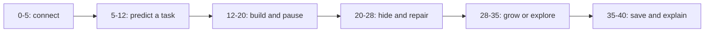

# Organize a BrickLab lab

**Goal:** pairs can explain a dependency, a handoff, and an inspect-repair loop
after a 30-45 minute session. You need technical confidence, not coding experience.
Give participants the [student guide](student-guide.md).

## Go/no-go before learners arrive

| Ready? | Decision |
| --- | --- |
| An offline plan builds, repairs and saves on the actual learner path | **Go** with the core lab |
| AI login, allowance or model access is unverified | **Go offline**; omit the optional AI comparison |
| Learners cannot reach a working workspace | **No-go for hands-on work**; use your rehearsed demo while fixing access |

## Run the room



| Activity | Facilitation prompt |
| --- | --- |
| Connect and choose templates | "Which decisions do you expect a team to share?" Check everyone reaches a build without AI. |
| Plan a purple brachiosaurus; open **Task board** | "Which job must wait?" Ask for a named prerequisite. |
| Single-step, run, pause, fast-forward | "Can both builders make progress?" Follow actual handoffs, not imagined conversations. |
| Finish, **Hide bricks**, **Ask team to repair** | "How did it know what was missing?" Compare planned identities and inspect again. |
| **Add to scene**, or try the separate playground | "What stayed unchanged?" |
| Save and exchange explanations | "Where was a model needed?" Templates and the crew are deterministic. |

For a five-minute demo: plan, predict one dependency, build fast, hide/repair,
then ask the last question. Skip setup and optional AI live on stage.

## Choose a setup

| Path | Who prepares it? | What learners need |
| --- | --- | --- |
| [Local computer](#local-computer) | You or each pair | Node.js, npm, repository download and a browser; no model account for templates |
| [Private Codespaces](#private-codespaces) | Each Codespace owner, with your help | GitHub access and Codespaces allowance; separate CLI authorization only for AI |
| [Azure self-hosting](#azure-self-hosting-advanced) | An experienced Azure operator | The operator's HTTPS URL; no visitor sign-in in anonymous hosted mode |

**First lab:** prefer local offline templates on prepared computers. Choose
Codespaces when local installation is impractical and account access has been
rehearsed; choose Azure only with an operator already responsible for the host.
Plan one workspace per pair, not one shared private credential for the class.

Do not expose a local server publicly or share a Codespace's temporary app
password with the room. One learner's account is not a class-wide model license.
Check your organization's account, age, privacy and spending policies first.

## Local computer

Install **Node.js 22.12+ and npm**. Download and extract this repository, or clone
it with Git. Open a terminal in the folder containing `package.json`:

```sh
npm ci
npm run dev
```

Open **http://127.0.0.1:4173** on that computer. Choose **Change mode ->
Use offline templates**. The initial Copilot selection does not mean AI is ready.
Use **Run an offline demo** to check the room's baseline.

For a built, non-development server, stop your own development server first:

```sh
npm run build
npm start
```

Stop your own foreground server with **Ctrl+C** after the session. Keep its
listener on loopback; this is not a recipe for classroom LAN hosting.

### Optional Copilot planning

Do this before the lab, not during the first exercise. Install the standalone
[Copilot CLI](https://docs.github.com/en/copilot/how-tos/copilot-cli), then
authenticate **in the environment running the server**:

```sh
npm install -g @github/copilot
copilot login
```

Restart your own server with the opt-in. Bash:

```bash
BRICKLAB_COPILOT=1 npm run dev
```

Windows PowerShell additionally requires the actual standalone native executable
and a trusted Microsoft Store PowerShell 7 runtime for process containment:

```powershell
$env:BRICKLAB_COPILOT = '1'
$env:BRICKLAB_COPILOT_BIN = 'C:\path\to\standalone\copilot.exe'
npm run dev
```

Replace the example executable path. Use `Get-Command copilot -All` and
`copilot --version` to detect an IDE shim. Desktop/IDE sign-in, `gh auth`, or
an installed CLI alone does not establish CLI entitlement or model access.
An explicit **Send brief to Copilot** submission checks that path and may use
quota. No silent template fallback is made on failure.

### Optional private Copilot images

Merged PR #27 adds Linux/private Codespaces support as well as the existing
Windows path. Keep it out of the core lab: real Codespace image acceptance has
not been completed. Images are off by default and unavailable to public hosted
Copilot planning. The private server needs both `BRICKLAB_COPILOT=1` and
`BRICKLAB_COPILOT_IMAGES=1` before startup; selecting a file still requires
per-request consent and an explicit planning submission.

Linux attachments use owner-only, request-owned temporary files and the CLI's
documented [`--attachment` option](https://docs.github.com/en/copilot/reference/copilot-cli-reference/cli-programmatic-reference).
Cancellation targets the managed process group; file deletion is attempted after
the managed process exits. Cleanup is best-effort: escaped descendants or a crash
can leave data behind. Delete **disposable lab Codespaces** after preserving wanted work;
closing the tab or stopping the Codespace does not delete its storage.
[Copilot session data can be retained or synced](https://docs.github.com/en/copilot/concepts/security-governance-and-network-settings/session-data);
deleting a Codespace does not delete synced data. Use synthetic images only.

### Operator-configured Compatible AI

A private lab operator can optionally configure a provider that implements the
OpenAI-compatible **chat-completions** protocol. This is a protocol contract,
not a claim that every provider or model will work. The server sends a
non-streaming request using `max_tokens` and `response_format: {type:
"json_object"}`; it expects one completed assistant message containing JSON
geometry. Verify that the chosen endpoint/model supports those request and
response fields. No particular real provider or model has been verified.

Set these in the server process environment before startup:

```text
BRICKLAB_COMPATIBLE_AI=1
BRICKLAB_COMPATIBLE_ENDPOINT=https://provider.example/v1/chat/completions
BRICKLAB_COMPATIBLE_MODEL=your-provider-model-id
BRICKLAB_COMPATIBLE_API_KEY=your-server-only-token
```

The endpoint must be the full chat-completions URL, not a base URL; HTTPS is
required except for literal loopback HTTP. Omit the API-key setting only when
the provider needs no bearer token. Keep the token in an operator-managed
secret store or private process environment; never put it in browser settings,
share it with learners, commit it, or print it in logs. Restart the private
server after changing configuration.

For private Copilot-image-compatible input to this provider, the operator must
also set `BRICKLAB_COMPATIBLE_VISION=1`, and the selected endpoint/model must
support OpenAI-style image content in chat messages. That setting is an
operator assertion, not a capability probe; each image still requires explicit
user consent. Otherwise use text only.

The UI discloses the configured service origin. Only an explicit planning
submission sends the brief (and, with separate consent, the selected image) to
that endpoint; provider charges and data handling are the operator's
responsibility. There is no preflight provider call and no silent fallback to
templates. Select **Use Compatible AI** only after reviewing the destination.
Compatible AI is rejected in public hosted mode and requires the app server to
remain bound to loopback. In Codespaces, keep the app behind its private port
proxy; do not bind it publicly to enable BYO. Automated tests cover the proxy
path with a fake provider, but real Codespaces forwarding and real provider
inference have not been verified.

## Private Codespaces

1. [Create a Codespace](https://codespaces.new/ribumann/lego-builder-agents).
   Review GitHub's usage terms. Startup installs dependencies, installs Copilot
   CLI 1.0.112 only if missing, builds, and starts the production server in the
   background. Existing CLI installations are checked, not replaced.
2. Allow automatic workspace tasks **only if you trust this repository**.
   The **BrickLab Codespace** terminal shows startup progress and the temporary
   app password. If that terminal is absent or tasks are disabled, open a private
   terminal and run `npm run codespace:connect`.
3. The helper offers CLI device login; default is to skip. Authorize in your
   own browser only if you want AI planning. Never paste device codes or tokens
   into chat. Login and startup send no model request.
4. In **Ports**, keep **4173 (BrickLab)** **Private**, not organization-visible.
   Open its exact HTTPS URL. GitHub authenticates the private port; BrickLab's
   additional browser prompt needs username **bricklab** and the temporary
   **app password** from your terminal, never your GitHub password.
5. Select offline templates for the first exercise. Stop the Codespace afterward
   to avoid unnecessary usage.

Reconnect preserves a running server and its password; a server restart rotates
the password. Do not start `npm run dev` or a second manual server beside the
startup worker. Existing Codespaces need a container **rebuild** to apply changed
devcontainer configuration; preserve work first. Reconnecting is not updating.

If startup fails, use:

```sh
npm run codespace:status
npm run codespace:start
npm run codespace:connect
```

`status` reports the phase and a private log location; `start` explicitly retries
startup without replacing an occupied port. Inspect logs privately. For a
shareable, bounded diagnostic, keep the server running and use a second terminal:

```sh
node scripts/diagnose-codespaces.mjs
```

Share only its fixed classifications and HTTP codes, not passwords or raw logs.
Port verification can fail even when GitHub API authentication works. Check the
selected GitHub CLI, account access and connectivity; **never make the port
public as a workaround**. Token overrides can supersede saved Copilot login:
review them privately using
[GitHub's authentication guide](https://docs.github.com/en/copilot/how-tos/copilot-cli/set-up-copilot-cli/troubleshoot-copilot-cli-auth).
Do not clear or switch accounts on someone else's behalf.

## Azure self-hosting (advanced)

Ask an operator to follow the [Azure self-hosting runbook](self-hosting-azure.md)
and [planner configuration](azure-planner.md). This creates billable resources
and requires identity, private storage, DNS, edge protection and deployment work.
It is not a one-click student setup. Paid planning is **off in the base template**.

Before distributing your own HTTPS URL, the operator should verify the intended
package, HTTPS and origin restrictions, allowance status, offline build, and a
separately authorized synthetic planning/build request if AI is enabled.
Anonymous visitors use the backend identity, not personal Copilot credentials.
Default public allowance is shared across everyone: 50 submissions per UTC day,
with at most two model requests per submission. It is not a billing cap.

## Rehearse before people arrive

| When | Prepare |
| --- | --- |
| A few days before | Choose the path; check device/software installation rights, GitHub/Codespaces allowances, organization policy and any authorized AI budget |
| An hour before | Rehearse on the actual path, verify the host, download an offline fallback build and prepare the student-guide link |
| On arrival | Pair learners, connect everyone, choose templates and confirm a first build before optional AI |

On the actual learner device/path, complete an offline plan, one step, a full
build, damage, repair, download and reload. Check the projector, browser graphics
and network. Keep a downloaded offline build as a fallback. If AI is part of the
session, test one synthetic brief with the account/operator's permission; a green
status alone is not proof of inference.

Count planned AI submissions across the room, not per device: for example,
15 pairs making four submissions need 60, above the default public Azure
allowance of 50 (other visitors may also consume it). Reserve optional AI for
one small comparison; keep templates as the reliable core activity.

Use diagrams and the task board when graphics are unavailable. Do not depend on
image generation, large scenes or a live provider for the core lesson. Voice
input is unavailable in the app.
See [current evidence and gaps](architecture.md#deployment-and-release-evidence).

## Scenarios and unblocking

| Try | Teaching point or recovery |
| --- | --- |
| `Build a green stegosaurus with a long tail.` | Templates: change body color/tail; arbitrary geometry is not supported |
| `Build a white cargo spaceship with two engines.` | Switch to **Space dock** first; compare structure and finishing tasks |
| **Load local Jurassic herd** / **Load local space fleet** | Multi-object examples without model calls |
| AI only: `A small blue room with an open doorway and an orange chair.` | Select **Try a hollow interior**; cutaway reveals, but does not create, a cavity |
| Planner unavailable or slow | Cancel if appropriate; deliberately switch to offline templates or load a local example |
| HTTP 429 / allowance exhausted | Shared capacity or daily allowance is not a broken learner account; avoid repeated submissions |
| Inspection stays red after repair | Missing-brick repair cannot fix a disconnected blueprint; replace/simplify the design |
| Browser blank/slow | Use task-board text, reduce scene size, reload only after saving; no FPS guarantee |
| Server says planning is quarantined | Stop submitting; operator must verify process/attachment cleanup before restart |

Keep briefs fictional. Image consent sends the original image, including possible
metadata, to the disclosed provider. Voice input is unavailable; typed briefs
remain supported. See the [voice backlog](voice-integration.md).
