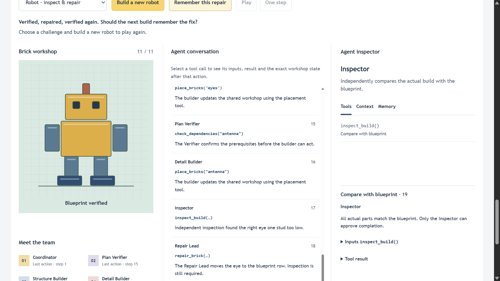
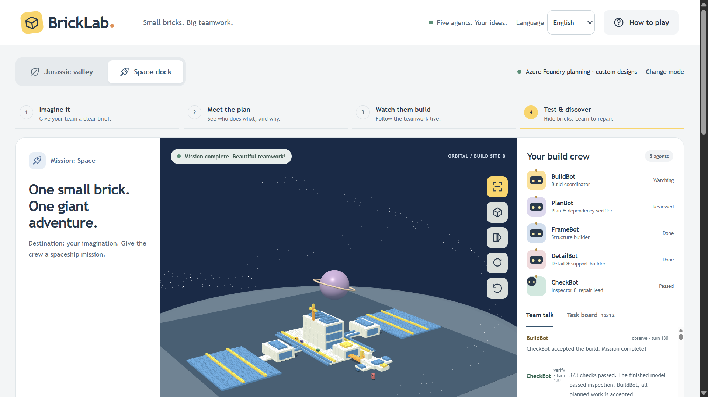

# BrickLab screenshot gallery

These are real app captures. The Jurassic herd, space fleet, task board and
playground repair are deterministic offline examples from an isolated preview
with providers disabled. The orbital station is a separate historical capture
from the hosted Azure Foundry demo, following one explicit planning submission
with a synthetic image and brief. Only that submission used a provider; no
personal data was used. This capture does not establish behavior of any newer
or separate deployment.

## Jurassic herd

*A completed 400-brick local herd and the team's finished inspection.*

## Space fleet

*Three local objects, 14 of 14 tasks complete, all three custom-design checks passed.*

## Task board

*The visible rows show Blue Explorer structure tasks; the counter reports all 14 fleet tasks complete.*

## Playground repair

*In the separate local playground, the inspector finds the right eye one stud too low; the repair lead moves it, and the inspector verifies the blueprint.*

## Hosted Azure image plan

*Historical capture from 2026-11-17, after one hosted Azure planning submission with a synthetic orbital-station reference image. The model proposed 2,083 bricks across 12 tasks: a connected 2,072-brick station and 11-brick shuttle. The local agents placed the design and passed all three checks; this does not verify physical stability or any separate deployment.*
