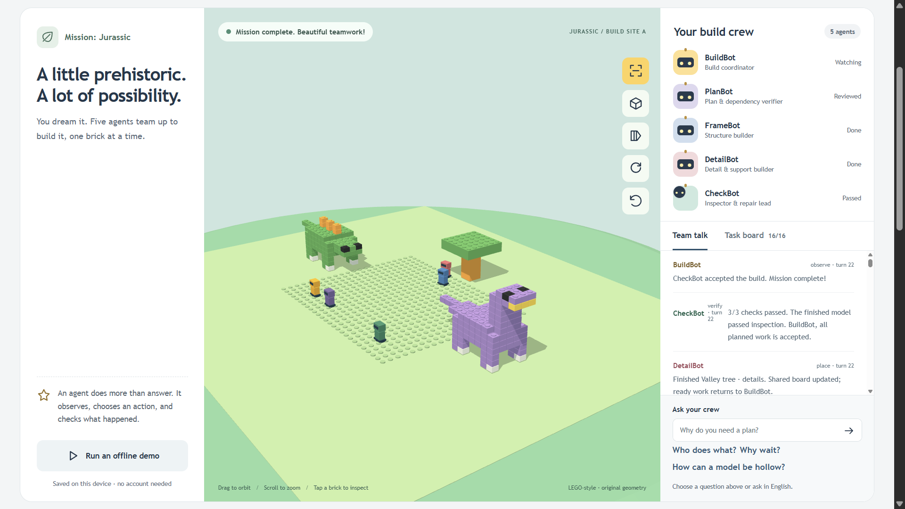
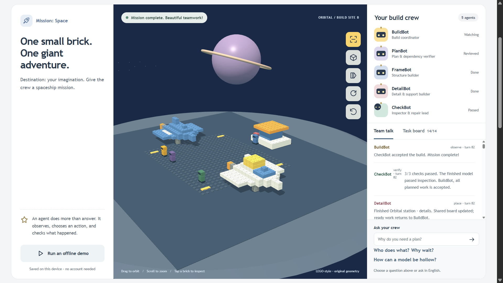
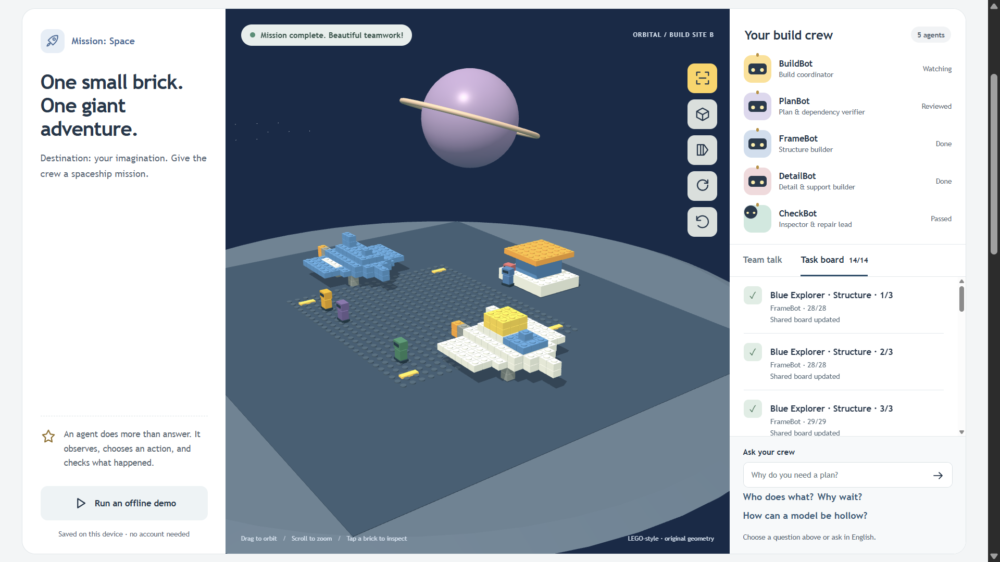

# BrickLab screenshot gallery

These are real captures from an isolated local preview with all providers
disabled. The dinosaur and fleet are deterministic offline examples; no image
below is model-generated. They show real app UI and original project graphics.

## Jurassic herd

*A completed 400-brick local herd and the team's finished inspection.*

## Space fleet

*Three local objects, 14 of 14 tasks complete, all three custom-design checks passed.*

## Task board

*The visible rows show Blue Explorer structure tasks; the counter reports all 14 fleet tasks complete.*

## Playground repair

*In the separate local playground, the inspector finds the right eye one stud too low; the repair lead moves it, and the inspector verifies the blueprint.*
