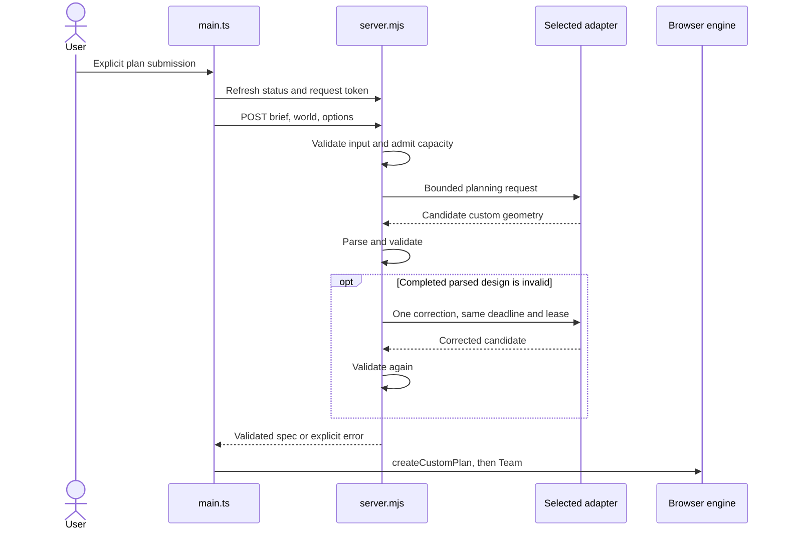

# Develop BrickLab

**Follow one brief from UI to validated geometry to deterministic execution.**
Use the [architect guide](architecture.md) for L0 context, deployment/trust
boundaries and release evidence; [student exercises](student-guide.md) reproduce
the behavior you are changing.
Use this guide to locate a change, preserve its invariants and identify the
evidence needed before calling it ready.

Levels here are **L1** runtime/code map, **L2** interactions, **L3** domain
algorithms, and **L4** concrete contracts. They are documentation zoom levels,
not independent deployable layers.

## Work locally

Use Node.js 22.12+ and npm in the repository root:

```sh
npm ci
npm run dev
```

Open http://127.0.0.1:4173 and select offline templates. For a production-shaped
run, stop your development server, then `npm run build` and `npm start`.
Provider opt-ins belong to the server environment; see
[Copilot setup](lab-organizer.md#optional-copilot-planning) or
[Azure configuration](azure-planner.md). Never commit credentials.

## L1: code and deployment map

| Area | Start with | Artifact or role |
| --- | --- | --- |
| Browser workflow | [`src/main.ts`](../src/main.ts) | Consent, planning, controls, persistence/import |
| Domain | [`src/engine.ts`](../src/engine.ts), [`src/custom-design.mjs`](../src/custom-design.mjs) | Typed plans, canonical geometry, deterministic `Team` |
| Scene | [`src/scene.ts`](../src/scene.ts), [`src/scene-append.ts`](../src/scene-append.ts) | Three.js instances, picking, transactional append |
| Teaching surfaces | [`src/agent-insights.ts`](../src/agent-insights.ts), [`src/agent-playground-engine.ts`](../src/agent-playground-engine.ts) | Retained engine state versus isolated six-role sandbox |
| Node host | [`server.mjs`](../server.mjs) | Development/production serving and explicit provider routes |
| Provider contracts | [`planning-prompt.mjs`](../planning-prompt.mjs), [`copilot-output.mjs`](../copilot-output.mjs), [`azure-planner.mjs`](../azure-planner.mjs) | Shared prompt, strict CLI events, Azure structured output |
| Admission | [`planning-capacity.mjs`](../planning-capacity.mjs), [`planning-quota.mjs`](../planning-quota.mjs), [`azure-usage.mjs`](../azure-usage.mjs) | In-flight leases and distinct public Azure submission counting |
| Codespaces | [devcontainer](../.devcontainer/devcontainer.json), [startup](../scripts/codespaces.mjs), [diagnostic](../scripts/diagnose-codespaces.mjs) | Private production startup and terminal onboarding |
| Azure | [`infra/azure.bicep`](../infra/azure.bicep), [packager](../scripts/package_azure_release.py) | Build/package plus separate private-network, edge and domain templates |
| Actions mission | [workflow](../.github/workflows/ai-mission.yml), [`scripts/ai-team.ts`](../scripts/ai-team.ts) | Three model decisions -> validated downloadable mission, not a runtime adapter |

TypeScript/Three.js run in the browser; Vite builds static assets. Node serves the
application and optional planning APIs. There is no React layer or shared
server-side scene store. Deployment commands and prerequisites stay in the
[Azure runbook](self-hosting-azure.md).

## L2: one external planning request



Routes are `/api/plan` (Copilot), `/api/azure-plan`, `/api/local-plan`, and
`/api/compatible-plan`. Offline `parseBrief -> createPlan -> Team` bypasses
provider requests. Local/compatible adapters remain backlog support.

No automatic provider/template fallback occurs. Malformed JSON, incomplete
output, authentication, transport, 429 and timeout failures do not get the
design-correction retry. Both permitted attempts share one deadline, cancellation
signal and capacity lease. Status availability is not proof of provider access.

Copilot uses scripting JSONL, not rendered terminal text. Only a final completed
assistant message with a successful terminal result is eligible for parsing.
The CLI has model tools, built-in MCPs and repository instructions disabled.
Windows text/image work requires native executable/Job containment; private
image attachments additionally require verified owner-only ACLs. This snapshot
does not include pending Linux image support in #27.

## L3: execution and invariants

| Operation | Algorithm and invariant | Focused evidence |
| --- | --- | --- |
| Plan | `createCustomPlan` validates/canonicalizes once before constructing browser tasks; direct `createPlan` custom inputs still validate | [`custom-design.test.ts`](../tests/custom-design.test.ts), [`engine-complex-design-stages.test.mjs`](../tests/engine-complex-design-stages.test.mjs) |
| Review | `Team` constructor checks missing/duplicate tasks, unknown dependencies and cycles; records disconnected geometry for inspection | [`engine.test.ts`](../tests/engine.test.ts) |
| Step | In order, FrameBot and DetailBot each select their first eligible owned task; place 1-20 bricks per role per tick according to batch | [`engine.test.ts`](../tests/engine.test.ts) |
| Inspect | Compare planned identities, per-object face connectivity and budget; templates also check balance | [`engine.test.ts`](../tests/engine.test.ts) |
| Damage/repair | Remove about one-third deterministically; route missing identities back to original owners, reopen handoffs, inspect again | [`engine.test.ts`](../tests/engine.test.ts), [`game.spec.ts`](../tests/browser/game.spec.ts) |
| Append | Validate canonical contributions, search x/z translations in increasing Manhattan distance, revalidate combined limits before replacing state | [`scene-append.test.ts`](../tests/scene-append.test.ts), [`scene-growth.spec.ts`](../tests/browser/scene-growth.spec.ts) |
| Restore | Reconstruct geometry from validated spec; don't trust arbitrary imported bricks or source attribution | [`engine.test.ts`](../tests/engine.test.ts), [`scene-append.test.ts`](../tests/scene-append.test.ts) |
| Learn in playground | Explicitly save one inspected repair rule; next robot recalls it; separate local key, not model training | [`agent-playground.test.ts`](../tests/agent-playground.test.ts) |

"Parallel builders" means dependency-aware progress in the same deterministic
tick loop, not threads or two LLM calls. Events retain at most 120 actions.
Large partial builds defer full connectivity work until completion (or damage).
Repair cannot invent geometry to connect an already-disconnected blueprint.

Append sends only the new brief/world/options to the planner, not the existing
scene. Local placement preserves the original and translates the addition;
contribution sources/offsets survive save/restore but are not signed provenance.

## L4: concrete contracts

### Geometry

A minimal custom spec accepted by the shared contract:

```json
{
  "world": "space",
  "model": "custom",
  "color": "blue",
  "longTail": false,
  "wideWings": false,
  "budget": 2,
  "design": {
    "name": "Two-brick study",
    "objects": [{
      "name": "Base and cap",
      "bricks": [
        {"x": 0, "y": 0, "z": 0, "width": 1, "height": 1, "depth": 1, "color": "blue", "part": "frame"},
        {"x": 0, "y": 1, "z": 0, "width": 1, "height": 1, "depth": 1, "color": "red", "part": "detail"}
      ]
    }]
  }
}
```

Custom designs allow **32 objects, 256 compact records, 8,192 expanded bricks,
262,144 occupied cells**, dimensions 1-8, occupied x/z -64..63 and y 0..63.
Repeats count bricks, including the first; dimensions multiply occupied cells,
not brick count. Named objects can be separate, but each must be face-connected
to pass inspection. No overlap, silent clipping or geometry fabrication.
The usual scale target is 1,000 bricks / 32,768 cells, not a device guarantee.
Decorative studs are sampled above 8,192 per model/blueprint; bodies are not omitted.

### State and persistence

`Spec -> Plan {tasks, assumptions, source} -> Team {bricks, events, tick, status}`.
The version-1 `Snapshot` stores spec, prompt, placed bricks, task order, events,
source and assumptions. Append extends it with contribution/offset and appearance
metadata. `main.ts` saves per world in `bricklab-jurassic` / `bricklab-space`;
playground lessons use `bricklab-agent-playground-memory-v1`.

### Failure and cleanup

Admission defaults and public usage semantics are in
[architecture](architecture.md#capacity-cost-and-failure-boundaries).
Capacity covers body reading, provider work and cleanup. Client response
termination is not lease release. Unconfirmed Copilot process cleanup globally
quarantines planning; operators verify processes and request-owned temporary
files before restart. Do not add a timed unlock or assume leader exit proves
descendant termination. No HTTP abort proves upstream compute or billing stopped.

## History and experiments

These are merged milestones visible in Git history, not evidence that every
deployment runs them. Links target the repository's recorded PRs:

| Milestone | What changed / lesson |
| --- | --- |
| [#1](https://github.com/ribumann/lego-builder-agents/pull/1) | Initial agentic builder demo |
| [#2](https://github.com/ribumann/lego-builder-agents/pull/2), [#3](https://github.com/ribumann/lego-builder-agents/pull/3) | Private Codespaces path, cloud-first custom planning and five-agent execution; keep templates distinct from inference |
| [#4](https://github.com/ribumann/lego-builder-agents/pull/4), [#5](https://github.com/ribumann/lego-builder-agents/pull/5) | Interactive playground, then clearer challenge flow; isolate learning memory from workshop state |
| [#6](https://github.com/ribumann/lego-builder-agents/pull/6), [#7](https://github.com/ribumann/lego-builder-agents/pull/7) | Approximate size targets and serialized software-rendered CI checks; targets are not output guarantees |
| [#21](https://github.com/ribumann/lego-builder-agents/pull/21) | Bounded parallel planning and anonymous Foundry access; concurrency limits are not measured speedup |
| [#22](https://github.com/ribumann/lego-builder-agents/pull/22), [#23](https://github.com/ribumann/lego-builder-agents/pull/23) | Single-pass custom-plan construction and reconciled release evidence |
| [#24](https://github.com/ribumann/lego-builder-agents/pull/24), [#25](https://github.com/ribumann/lego-builder-agents/pull/25), [#26](https://github.com/ribumann/lego-builder-agents/pull/26) | Private proxy Host/Origin fixes and unattended startup with explicit terminal login |

**Not shipped:** the prior release documentation records a separate prompt/output
latency experiment whose small paired sample showed no end-to-end improvement.
It is not on this source path and is not a performance baseline or 2x claim.
**Pending at 2026-11-17:** [#27](https://github.com/ribumann/lego-builder-agents/pull/27)
proposes private Linux Copilot image planning; do not describe it as released.
Live Azure examples and unverified paths are tracked in
[release evidence](architecture.md#deployment-and-release-evidence).

## Check a change

For a first engine change, reproduce a student exercise, read `Team` and the
matching case in `tests/engine.test.ts`, then run:

```sh
node --import tsx --test tests/engine.test.ts
```

For planner failures, begin at the selected route in `server.mjs` and its adapter
test rather than the renderer. For display-only failures, start with `src/scene.ts`
and the matching browser journey. Broaden checks as the change requires:

```sh
npm test
npm run build
npx playwright install chromium
npm run test:e2e -- --workers=1
```

Use the smallest relevant existing tests first. CI serializes Playwright's
software-rendered scenes; native Windows containment tests need Windows and are
skipped by Linux CI. Mock providers test contracts, not entitlement, live vision,
real forwarding or billed service behavior. No paid inference belongs in CI.
For documentation-only work, validate links, commands and fenced examples rather
than running the application suite.

## Challenges worth improving

| Opportunity | Useful acceptance evidence |
| --- | --- |
| Classroom onboarding | Real local/Codespaces learner walkthrough, with redacted phase/error observations |
| Provider reliability and visual fidelity | Consented synthetic cases, exact revision/provider and outcome; distinguish schema validity from resemblance |
| Latency | Matched end-to-end runs with the same briefs/model/settings; do not infer speed from capacity |
| Scale | Real-device rendering/memory measurements; do not extrapolate CPU or fixture results to FPS |
| Voice and images | Real device/provider consent, cancellation and usability checks; keep typed/offline routes usable |
| Maintainability | Extract a boundary only when a concrete change needs it; preserve fail-closed validation and focused tests |

Report reproducible issues with a synthetic brief, setup, revision and expected
versus actual result. Exclude secrets, private identifiers and raw provider logs.
