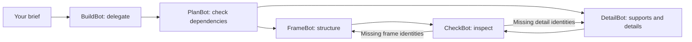

# Take the BrickLab lab

**Your mission:** build something with a team, catch a mistake, and explain how
the team recovered. Work in pairs: one person drives, the other predicts; swap
after each exercise.

## Get to your workspace

| Your setup | Start here |
| --- | --- |
| Local computer | If already running, open **http://127.0.0.1:4173** on that computer. Otherwise follow [local setup](lab-organizer.md#local-computer); it needs Node.js and npm, not an AI account. |
| Private Codespace | Start/resume your own Codespace. Allow automatic tasks only if you trust the repository, or run `npm run codespace:connect` yourself. Open private port 4173; use `bricklab` and the temporary app password from that terminal. Do not start a second server. Follow [the full steps](lab-organizer.md#private-codespaces) if blocked. |
| Azure-hosted lab | Open the HTTPS URL your organizer supplies. There is no local install or visitor sign-in for anonymous hosted mode. If no URL is ready, use local setup or Codespaces; do not provision Azure just to take the lab. |

### Codespaces recovery card

| Stuck at... | Try this |
| --- | --- |
| Workspace stopped | Resume your own Codespace and wait for startup |
| No helper terminal | Open a terminal in the project and run `npm run codespace:connect`; do not start a second server |
| Browser password rejected | Run `npm run codespace:connect` again for the current temporary **app** password; a server restart changes it |
| Page denied / 403 | Keep port 4173 **Private**. Run `npm run codespace:status` and give the organizer only the phase/error category |
| AI login or planning fails | Choose **Change mode -> Use offline templates**; AI is not needed for the exercises |

Never paste passwords, device codes or raw logs into chat. When finished, preserve
wanted downloads and ask the organizer about deleting a disposable lab Codespace;
stopping it leaves stored data behind.

You can do the core lab without an AI account. Select **Change mode ->
Use offline templates** even if Copilot is initially selected.
Do not enter your GitHub password into BrickLab. Do not put names, photos of
people or other private information into prompts.

## 1. Meet the team (5 minutes)

Choose **Jurassic valley**, enter this brief, and select **Make a plan**:

```text
Build a purple brachiosaurus with a tall neck.
```

Open **Task board**. Before building, name one job that must wait for another.
Take **Build one step**, then start/continue the build. Pause and compare your
prediction with the actual board and team messages.



The five roles are deterministic program logic. Offline templates recognize a
limited vocabulary; they cannot invent every subject you type. Team messages
describe actions, not hidden model thoughts.
During repair, BuildBot routes missing identities to their original builder
owners; PlanBot rechecks task prerequisites, not a newly invented blueprint.

**Checkpoint:** explain why waiting can be the correct action.

## 2. Change one thing (5 minutes)

Finish the build, or save it before replacing it. Try a green stegosaurus with
a long tail. Then switch to **Space dock**:

```text
Build a white cargo spaceship with two engines.
```

Compare tasks, not just appearance. Use **1x / 4x / 16x** to move faster after
you understand a handoff. **Exploded view** separates the display; it does not
damage the saved build.

**Checkpoint:** which changes came from the brief, and which details stayed fixed?

## 3. Break, inspect, repair (5 minutes)

Once the mission is complete, select **Hide bricks**. About one-third are removed.
Read the failed inspection before choosing **Ask team to repair**.

Predict which builder will receive a reopened job. Watch the missing identities
return, then read the inspection again. A template normally finishes with four
checks; custom designs use three. "Brief fulfilled" checks planned bricks, not
whether a model understood every word of your idea.

**Checkpoint:** why is rebuilding missing bricks different from fixing a bad plan?

## 4. Grow and keep your scene (5 minutes)

Choose **Add to scene**, describe another supported object in the same world,
and plan it. The original stays in place; BrickLab moves the addition to a
free location and shows its offset. **Replace scene** starts over instead.
If there is no room or a combined limit is exceeded, the existing scene stays.

Try **Load local Jurassic herd** or **Load local space fleet** for ready-made
multi-object examples; these are not model-generated results.

Use replay to revisit placements, then **Live** to return. Select **Save build
file** and keep the JSON. **Load build / AI mission** can load it later.
Refresh normally restores the per-world browser save, but cleared/private browser
storage may not keep it. A download is a file, not a public sharing link, and
contains your brief.

**Checkpoint:** what information would another person need to reproduce your result?

## 5. Try a model, only if configured (optional)

Ask the organizer which provider is ready. Merely choosing a mode or file does
not submit it. Read the destination disclosure before the explicit planning
button: the brief goes to that provider and may use quota or incur charges.
Never keep clicking to overcome an error.

Start small:

```text
A small lighthouse with a red roof. Budget 100 bricks.
```

Compare the result with your request. Geometry can be valid but still look wrong.
Approximate size is a target, not a guarantee. A failed provider does not secretly
switch to templates; you can choose templates yourself.

For an interior experiment, select **Try a hollow interior** and request a small
room with an open doorway. **Cutaway view** reveals the cross-section, but cannot
make a solid model hollow. Templates ignore the interior preference.
Image support depends on the server/platform; do not assume it is available.
Linux/private Codespaces image support is merged but not real-Codespace accepted;
the operator must opt in first. Each request needs separate consent, and images
may carry embedded metadata. Typing works without images. Voice input is not
available in the app; see the [voice backlog](voice-integration.md).

**Checkpoint:** separate "the model proposed it" from "the application checked it."

## 6. Look inside an agent (optional, 10 minutes)

Open **Extended agent insights**. Predict the next action, take one step, and
compare task context, shared memory and the retained action log. This is the
engine's program state, not another model call or an unlimited transcript.

Then open **The agent playground**, a separate six-role simulation:

| Challenge | Investigate |
| --- | --- |
| Robot | Who detects the misplaced eye, who repairs it, and why is a second inspection needed? |
| Missing brick | Can an independent task proceed while stock is unavailable? |
| Impossible plan | Why must a corrected dependency graph be verified before building? |

After an inspected repair, **Remember this repair** can save a local rule for
the next robot. It changes program behavior, not a model's training. Playground
memory is separate from your workshop save. See [playground controls](agent-playground.md).

## Get unstuck

| Symptom | Safe next action |
| --- | --- |
| Local install fails or Node is too old | Check `node --version` (22.12+ required) and `npm --version` in the project folder. Save the error category and ask the organizer about installation/network permissions; never share a raw credential-bearing log |
| Local page will not connect | Keep the server terminal open and check its startup result. Confirm the exact address/port; a stopped server cannot serve the page |
| Port in use / `EADDRINUSE` | Check whether your own BrickLab is already running. Do not kill another person's process or start more servers; ask the organizer to identify the port owner |
| "Copilot is off", missing CLI or login error | Use templates for the lab; [optional Copilot setup](lab-organizer.md#optional-copilot-planning) belongs in the server terminal, not browser settings |
| Codespace page asks for a password | Use the temporary **app** password shown by `codespace:connect`, not a GitHub password; after a server restart reconnect to retrieve the rotated password. Keep port 4173 private |
| Codespace startup/403 failure | Use the [Codespaces recovery card](#codespaces-recovery-card); give the organizer the phase/error category |
| Wrong-world message | Switch between Jurassic valley and Space dock to match the brief |
| Unsupported template idea | Use the shown dinosaur/ship examples, or a deliberately configured AI planner |
| Busy/HTTP 429 or no allowance | Tell the organizer; use templates instead of automatic/repeated retries |
| Repair never passes connectivity | Replace/simplify the blueprint; repair only replaces missing planned bricks |
| Lost save or graphics trouble | Load a downloaded build; use the text task board and smaller scenes |

Still blocked? Tell the organizer your setup path, the step you reached and the
fixed error category/status. Keep passwords, tokens and private briefs out of it.

## Explain what you learned

Show your partner one dependency, one actual handoff and one inspection finding.
Which state was shared? What could the inspector prove, and what could it not?
Where would a language model help, and where would you keep deterministic checks?

For the next level: [system architecture](architecture.md) or
[code and experiments](software-design.md).
